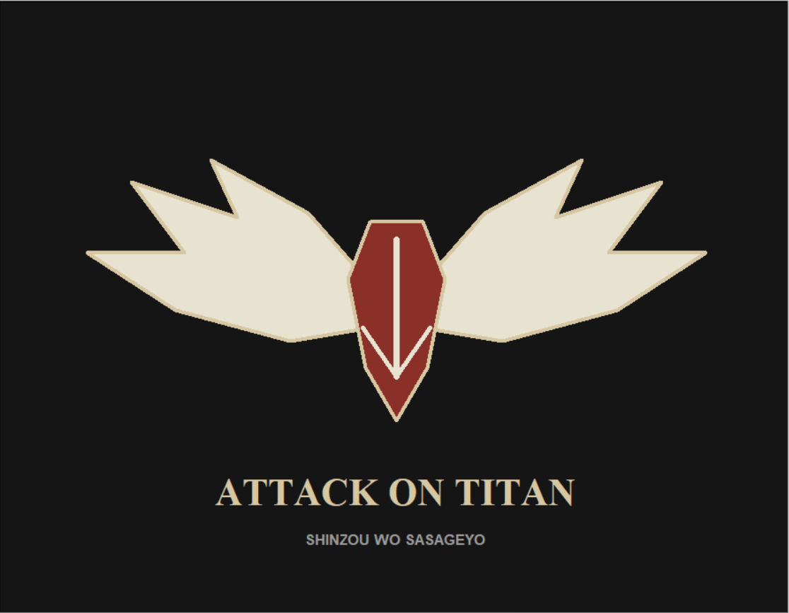

# ⚔️ ATTACK ON TITAN

<p align="center">
  <strong>ATTACK ON TITAN — Python Turtle Graphics Project</strong>
</p>

## 🖼️ Project Preview

<p align="center">
  
</p>

## 📌 About the Project

This project creates an **Attack on Titan logo** using Python Turtle Graphics.

The program draws a custom emblem featuring symmetrical wings, a central shield, a sword, and the title ATTACK ON TITAN.

It demonstrates how Python can be used to create graphical designs through coordinate-based drawing and geometric shapes.

## ✨ Features

- Symmetrical wing design
- Central shield with custom coloring
- Sword illustration
- Custom typography
- Dark background
- Smooth Turtle Graphics rendering

## 🛠️ Technologies Used

| Technology | Purpose |
|---|---|
| Python 3 | Programming language |
| Turtle | Graphics and drawing |
 
## 📋 Requirements

- Python 3.x
- Turtle module (included with standard Python installations)
- Desktop environment supporting graphical windows

No external libraries are required.

## 🚀 How to Run

**1. Clone the repository**

```bash
git clone https://github.com/anish041208-svg/Attack-on-Titan.logo.git
```

**2. Enter the project directory**

```bash
cd Attack-on-Titan.logo
```

**3. Run the Python program**

```bash
python main.py
```

## 📁 Project Structure

```text
Attack-on-Titan.logo/
│
├── main.py
└── README.md
```

## 🎯 Concepts Practised

- Python functions
- Turtle Graphics
- Coordinate geometry
- Polygon drawing
- Loops and conditional-free drawing logic
- Color customization

## 🔮 Future Improvements

- More detailed wing illustrations
- Improved shield and sword design
- Additional animation effects
- More detailed Attack on Titan typography

## ⚔️ Acknowledgement

Inspired by the anime **Attack on Titan (Shingeki no Kyojin)**.

This is an independent fan-made programming project and is not affiliated with or endorsed by the official creators or rights holders.

---

<p align="center">
  <strong>SHINZOU WO SASAGEYO! 🪽</strong>
</p>

